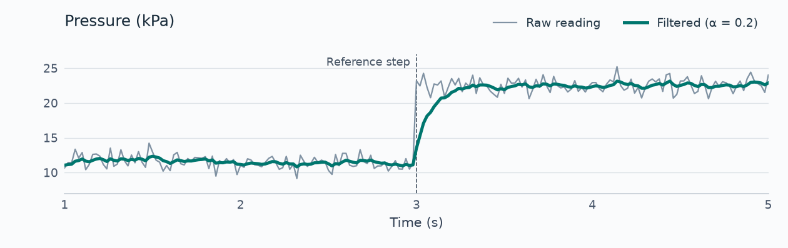

# LoopTrial

[简体中文](README.md) · **English**

LoopTrial is an experiment toolkit for embedded engineers and AI agents. Capture a waveform to diagnose a problem, or let your agent change a parameter, read it back, and repeat a trial under the same conditions. Each run has an ID so a teammate can inspect the raw samples and recalculate the result.

Suppose you've already told your agent that a heater normally runs at 50 °C. Later you can just say, “It takes too long to warm up.” The agent can discover the temperature signal, heater output and writable gains, measure a baseline, then compare warm-up time and overshoot. It can confirm an improvement with a fresh run or stop and show you where the heater was already at its output limit.

[Download v0.1.0](https://github.com/yuheng-null/LoopTrial/releases/tag/v0.1.0) · [CLI and MCP reference](docs/CLI.md) · [Device integration guide](docs/HARDWARE.en.md)

## Start with your agent

Give this page's URL and your symptom to an agent that can run local tools. For example, “I’m using the simulated pressure sensor. Its reading jumps around even at rest. How much does it vary?” Use the device and operating conditions already established in the conversation. With LoopTrial connected over MCP, call `devices` and `describe`, then use `run_experiment` with a supported action. A shell-enabled agent can use the CLI directly. From a clone, run `python -m pip install .` in a Python 3.11+ virtual environment at the repository root. With only the URL, follow the wheel installation under **Quick start** below.

For a first hardware-free diagnosis, run `looptrial describe sim://sensor`, then `looptrial run sim://sensor capture` and `looptrial review <id>` with the returned ID. Confirm the target before using hardware. For tuning, work within the existing write authorization, read back effective values and repeat the experiment. [Agent's experiment guide](src/looptrial/resources/agent-guide.en.md) · [CLI and MCP reference](docs/CLI.md)

## What you can do

| Task | Included example |
| --- | --- |
| Measure and filter a signal | Compare noise at rest and step-response delay using the same pressure trace. |
| Calibrate a sensor | Fit offset and scale to two known references, then check the error at a third, held-out point. |
| Tune a controller | Compare warm-up time and overshoot on a heater, tracking error and saturation on a motor, or tilt recovery and wheel drift on a two-wheel balancing model. |



Filtering this simulated pressure signal makes the reading steadier and adds about 0.2 seconds of response delay. The quick start reproduces the comparison.

## Quick start

Install Python 3.12 and the Windows Python Launcher. Download the [host wheel](https://github.com/yuheng-null/LoopTrial/releases/download/v0.1.0/looptrial-0.1.0-py3-none-any.whl) into an empty directory and open PowerShell there. Installation fetches dependencies. The included simulators run locally.

```powershell
py -3.12 -m venv .venv
.\.venv\Scripts\python -m pip install .\looptrial-0.1.0-py3-none-any.whl
$env:PATH = "$PWD\.venv\Scripts;$env:PATH"
$env:LOOPTRIAL_HOME = "$PWD\lab"
```

Use the same random seed twice so the filter receives identical input. Each `apply` returns the effective setting read back from the device.

```powershell
looptrial describe sim://sensor
looptrial apply sim://sensor alpha=1
$a = looptrial run sim://sensor capture --condition seed=17 | ConvertFrom-Json
looptrial apply sim://sensor alpha=0.2
$b = looptrial run sim://sensor capture --condition seed=17 | ConvertFrom-Json
looptrial compare $a.id $b.id
looptrial review $b.id
```

`compare` reports the change in each metric (second run minus first). Look in `lab/runs/<id>/` for the settings and conditions (`record.json`), timestamped samples (`samples.csv`), and waveform (`plot.svg`). Copy the folder to another computer with LoopTrial installed and run `looptrial review <folder>` to verify the samples and recompute the metrics offline.

## Connect your agent or device

- **Agents** can use the CLI or call the same operations through the Model Context Protocol (MCP). Register `looptrial-mcp` as a stdio server. On Windows, `(Get-Command looptrial-mcp).Source` prints its full path. Set the same `LOOPTRIAL_HOME` in both clients to share runs. To try a complete session with a standalone MCP client, run `looptrial-client`.
- **Physical devices** expose signals, units, writable parameters and supported actions through firmware or an adapter. The STM32F103 Blue Pill example supports a USB-to-UART bridge and a BD-BT26 BLE GATT connection. A small Python adapter can wrap an existing protocol. Sampling and real-time control run on the device or in a local process, while the agent decides what to try between runs.

## Documentation and license

[CLI and MCP reference](docs/CLI.md) · [Experiments and adapter example](docs/EXPERIMENTS.en.md) · [Wiring, protocol and firmware integration](docs/HARDWARE.en.md) · [Release and build guide](docs/RELEASE.en.md) · [Acceptance records](docs/ACCEPTANCE.en.md) · [Project goals](docs/GOAL.en.md) · [Upstream design references](docs/REUSE.en.md)

LoopTrial is licensed under **GPL-3.0-or-later**. Dependencies retain their respective licenses. [License](LICENSE) · [Third-party notices](THIRD_PARTY.md)
