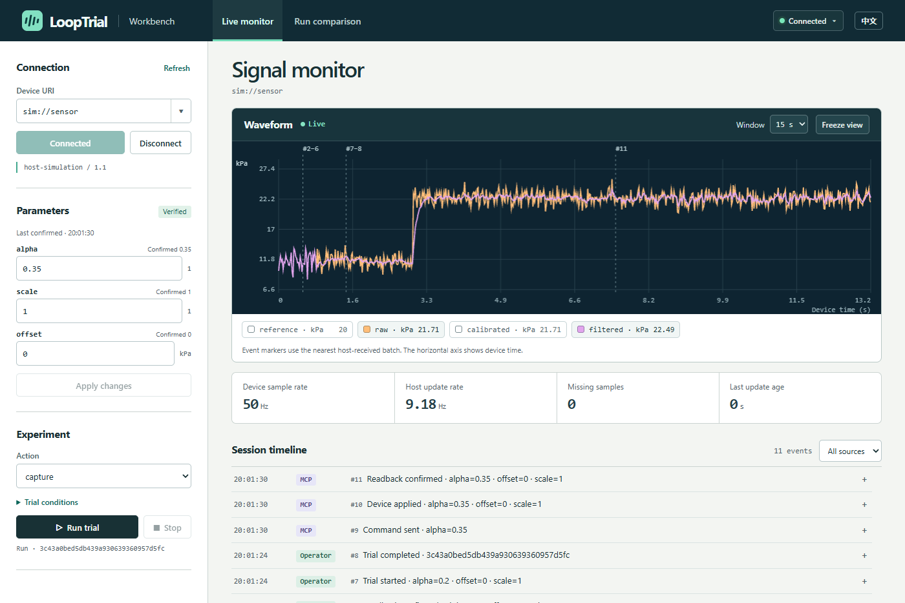

# LoopTrial

[简体中文](README.md) · **English** · [Download v0.2.2](https://github.com/yuheng-null/LoopTrial/releases/tag/v0.2.2)

LoopTrial is an embedded experiment workbench for engineers and their AI agents. Keep live signals on screen and describe a symptom to your own agent. In the bundled whole-car simulator, a request like “This car is slow through bends. Speed it up” can start an experiment. Its CLI or MCP calls share the device connection, read effective settings, test candidates and confirm results on the same timeline. A diagnosis can end after a single capture.



The published autonomous driving sessions used the v0.2 simulator candidate at `f326f20`. The recordings include the agent's tool calls, failed candidates and fresh confirmation laps. [Runs and simulator versions](docs/ACCEPTANCE-0.2.en.md)

## Install and open the workbench

On Windows with Python 3.12 and the Python Launcher installed, open PowerShell in an empty directory. Installation fetches dependencies. The workbench, plots, simulated devices and records run locally. The whole-car example requires an installed WebGL-capable Microsoft Edge or Chromium-based browser.

```powershell
py -3.12 -m venv .venv
.\.venv\Scripts\python -m pip install https://github.com/yuheng-null/LoopTrial/releases/download/v0.2.2/looptrial-0.2.2-py3-none-any.whl
$env:PATH = "$PWD\.venv\Scripts;$env:PATH"
$env:LOOPTRIAL_HOME = "$PWD\lab"
looptrial studio
```

In the browser, connect the default **sim://sensor**. Select raw and filtered pressure to watch the traces and units. Run **capture** for a baseline, change the current-sample weight **alpha** to **0.2**, apply it and check the confirmation. Capture again and select both IDs on the comparison page to overlay the traces. Leave the workbench open. For USB serial or BD-BT26 BLE, identify the board before connecting. [Hardware guide](docs/HARDWARE.en.md)

On a narrow screen, open the device controls from the connection button in the top bar. The waveform stays in view, with Run or Stop at the bottom. Each channel shows its last displayed reading. Freeze holds the trace while acquisition continues. Discard restores the editor to the latest device readback. Filter the timeline by Operator, CLI or MCP to follow who changed a setting.

## Start with your agent

Give this page's URL and your symptom to an agent with local tools. From a clone, run `python -m pip install .` at the root in a Python 3.11+ virtual environment. After installation use the CLI directly, or register that environment's `looptrial-mcp` in a stdio MCP client. Set the same absolute `LOOPTRIAL_HOME` in the workbench, CLI and MCP environment. Run `looptrial-client` to try a standalone client. Run `looptrial mcp-config` in the workbench environment for a ready-to-paste stdio configuration. Within the existing authorization the agent can discover capabilities and proceed through fresh confirmation runs. [Agent's experiment guide](src/looptrial/resources/agent-guide.en.md) · [CLI and MCP setup](docs/CLI.md)

Open a second PowerShell in the same directory. The first command after environment setup shows the shared connection and recent manual changes. The next three acquire and review a hardware-free trace. These experiment commands also work with the workbench closed.

```powershell
$env:PATH = "$PWD\.venv\Scripts;$env:PATH"
$env:LOOPTRIAL_HOME = "$PWD\lab"
looptrial live
looptrial describe sim://sensor
$r = looptrial run sim://sensor capture | ConvertFrom-Json
looptrial review $r.id
looptrial-client
```

## Drive a full lap in the YALI simulator

```powershell
looptrial describe race://yali
$lap = looptrial run race://yali lap --condition course=1 --constraint valid_lap:ge:1 | ConvertFrom-Json
looptrial review $lap.id
Copy-Item -Recurse "$env:LOOPTRIAL_HOME\runs\$($lap.id)" ".\lap-$($lap.id)"
looptrial review ".\lap-$($lap.id)"
```

From a stationary reset the YALI camera, line follower, steering and wheel controllers drive the vehicle. A valid finish requires eight ordered gates and staying within the marked corridor. Review the trajectory, gate crossings or departure event, controller output and verdict offline. [Whole-car experiments](docs/RACE.en.md) · [Release acceptance records](docs/ACCEPTANCE-0.2.en.md)

## Integration and reproducible experiments

- **Measurement and control.** Examples cover pressure measurement and filtering, two-point calibration with a held-out reference, heater response, wheel speed and small-angle balance. Compare fresh trials from matching conditions and inspect raw CSV, units, amplitude and delay. [Experiments and legacy logger adapter](docs/EXPERIMENTS.en.md)
- **Physical devices.** Projects with actuators must implement real-time control, physical limits and link-loss recovery in their firmware. The demo gain stays in RAM after a disconnect until changed or reset. The Blue Pill example supports USB-to-UART and BLE GATT. Continuous observations and on-board transient captures share the connection. Python adapters can wrap other protocols. For physical lap tuning, expose timestamped feedback, effective parameter readback, repeatable starts, and finish and off-course detection. [Wiring and integration](docs/HARDWARE.en.md) · [Current bench results](evidence/v02/board/README.en.md)
- **Portable records.** Each trial has a directory in `lab/runs/<id>` with timestamped `samples.csv`, conditions and settings in `record.json`, and a `plot.svg` for traces of at least two samples. Copy the complete directory to another computer with the corresponding version and adapter to recalculate offline. [Release, checksums and source builds](docs/RELEASE.en.md)

LoopTrial is **GPL-3.0-or-later**. Bundled components retain their own licenses. [License](LICENSE) · [Third-party notices](THIRD_PARTY.md) · [Release goals](docs/GOAL-0.2.en.md) · [Upstream design references](docs/REUSE.en.md)
