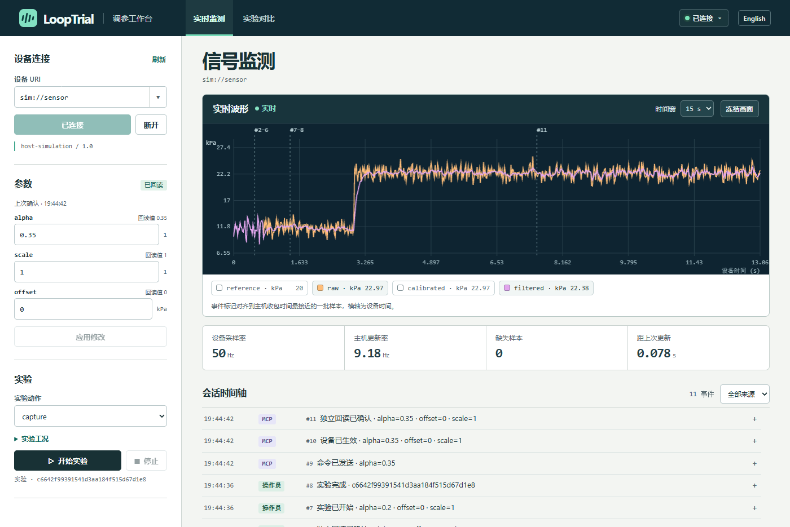

# LoopTrial

**简体中文** · [English](README.en.md) · [下载 v0.2.2](https://github.com/yuheng-null/LoopTrial/releases/tag/v0.2.2)

LoopTrial 是给嵌入式工程师和 AI Agent 共用的实验上位机。你可以开着实时波形看设备，对自己的 Agent 描述症状。在随包的整车仿真里，一句「这辆车过弯太慢，帮我调快一点」就可以开始实验。Agent 通过 CLI 或 MCP 使用同一次连接，读生效参数、试候选、复测，并把结果留在你能看到的时间轴上。一次诊断也可以只采一段波形。



## 安装并打开工作台

在有 Python 3.12 和 Python Launcher 的 Windows 电脑上，进入空目录，在 PowerShell 中运行。首次安装需联网，安装后工作台、图表、模拟器与原始记录都在本机。整车实验需要本机装有支持 WebGL 的 Microsoft Edge 或 Chromium 系浏览器。

```powershell
py -3.12 -m venv .venv
.\.venv\Scripts\python -m pip install https://github.com/yuheng-null/LoopTrial/releases/download/v0.2.2/looptrial-0.2.2-py3-none-any.whl
$env:PATH = "$PWD\.venv\Scripts;$env:PATH"
$env:LOOPTRIAL_HOME = "$PWD\lab"
looptrial studio
```

浏览器打开后，连接默认的 **sim://sensor**。选择原始压力和滤后压力可看到带单位的波形。运行一次 **capture** 作为基线，把当前样本权重 **alpha** 改成 **0.2**、写入并查看确认，再采一次。在比较页选这两个编号，即可叠图。工作台保持运行。USB 串口和 BD-BT26 BLE 可在设备选择器中选择，连接前按[硬件指南](docs/HARDWARE.md)核对目标。

窄屏上从顶栏的连接按钮打开设备面板，开始和停止实验在底栏。每个通道都显示当前画面的最后一个读数。冻结波形时采集仍在继续。撤销修改可让输入框回到设备最近的回读值。时间轴可以按操作员、CLI 或 MCP 筛选，追查一次参数变更。

## 给 Agent 的入口

把本页网址和症状发给能使用本地工具的 Agent 即可。克隆仓库后，在 Python 3.11+ 虚拟环境中从根目录执行 `python -m pip install .`。已安装时直接用 CLI，或在支持 stdio 的客户端注册同一环境中的 `looptrial-mcp`。工作台、CLI 和 MCP 使用同一个绝对路径 `LOOPTRIAL_HOME`，独立 MCP 客户端用 `looptrial-client`。已授权的调参可以从发现能力一直做到新试验确认。[Agent 实验指南](src/looptrial/resources/agent-guide.md) · [CLI 与 MCP 配置](docs/CLI.zh-CN.md)

在第二个 PowerShell 中进入同一目录，执行下面的命令。第一项可以看到当前连接和最近的人为改动。后面三项会在无硬件条件下完成一次取样和复核；关闭工作台也可独立使用这些实验命令。

```powershell
$env:PATH = "$PWD\.venv\Scripts;$env:PATH"
$env:LOOPTRIAL_HOME = "$PWD\lab"
looptrial live
looptrial describe sim://sensor
$r = looptrial run sim://sensor capture | ConvertFrom-Json
looptrial review $r.id
looptrial-client
```

## 在雷霆之车仿真中跑完一圈

```powershell
looptrial describe race://yali
$lap = looptrial run race://yali lap --condition course=1 --constraint valid_lap:ge:1 | ConvertFrom-Json
looptrial review $lap.id
Copy-Item -Recurse "$env:LOOPTRIAL_HOME\runs\$($lap.id)" ".\lap-$($lap.id)"
looptrial review ".\lap-$($lap.id)"
```

从静止复位后，雷霆之车的相机、巡线算法、方向与轮速控制器共同驱动车辆。试跑须按顺序通过八个检查点并始终处于允许路线内。轨迹、过点或出界事件、控制输出和成绩都可离线复核。换工况、优化过弯、查阅失败以及停止原因见[整车示例](docs/RACE.md)和[本版验收记录](docs/ACCEPTANCE-0.2.md)。

## 接入与可复现实验

- **仪器与控制器。** 内置压力测量和滤波、两点标定及第三点验证、温控、轮速和小角度直立。使用相同初态比较候选，查看原始 CSV、单位、幅度与响应延迟。[实验与旧记录器适配](docs/EXPERIMENTS.md)
- **真实设备。** 实时控制、限幅和超时留在设备侧。Blue Pill 示例支持 USB 转 UART 和 BLE GATT，持续观测与板端瞬态采集可共用连接。其他协议可通过 Python 适配器接入。要让 Agent 在实车上优化圈速，固件或适配器还需提供带时间戳的反馈、生效参数回读、可重复起跑、有效完赛和出界判定。[固件、接线与既有工程](docs/HARDWARE.md) · [本版台架](evidence/v02/board/README.md)
- **可移植记录。** 每轮独立存入 `lab/runs/<id>`，含带时间戳的 `samples.csv`、记录工况和参数的 `record.json`；至少有两个采样点时还会生成 `plot.svg`。整目录复制到装有相应版本和适配器的电脑可离线重算。[发布、校验和源码构建](docs/RELEASE.md)

LoopTrial 采用 **GPL-3.0-or-later**，随包组件附各自许可。[完整许可](LICENSE) · [第三方声明](THIRD_PARTY.zh-CN.md) · [本版任务书](docs/GOAL-0.2.md) · [开源复用](docs/REUSE.md)
